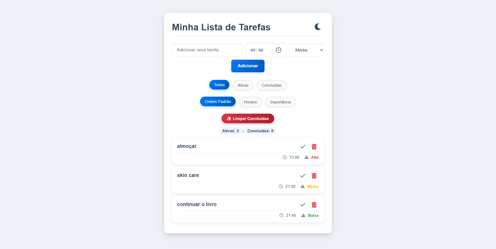
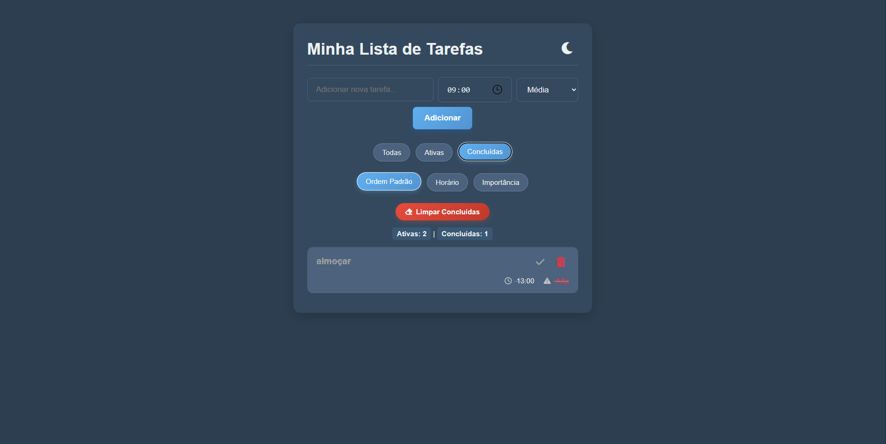

# Minha Lista de Tarefas

<p align="center">
  <a href="https://victorstavarengo.github.io/to-do-list/"></a>
  
  
  
</p>

<p align="center">
  Lista de tarefas com horário, prioridade, filtros, ordenação e tema claro/escuro.<br />
  Feita em HTML, CSS e JavaScript puro — sem framework e sem etapa de build.
</p>

<p align="center">
  <a href="https://victorstavarengo.github.io/to-do-list/"><strong>Abrir demo ao vivo</strong></a>
</p>

| Tema claro | Tema escuro |
| --- | --- |
|  |  |

## Sobre o projeto

Aplicativo de lista de tarefas feito em JavaScript puro para praticar manipulação de DOM, estado e UI. As tarefas e a preferência de tema ficam no `localStorage` do navegador — nada de servidor, login ou banco de dados — e continuam lá depois de recarregar a página.

## Funcionalidades

- **Cadastro rápido:** texto, horário e prioridade (Baixa, Média, Alta) em um único formulário.
- **Edição inline:** clique no texto, no horário ou na prioridade de uma tarefa para editar ali mesmo.
- **Conclusão e exclusão:** marcar/desmarcar com um clique e excluir com modal de confirmação.
- **Filtros:** Todas, Ativas e Concluídas.
- **Ordenação:** ordem de cadastro, por horário ou por prioridade.
- **Contadores:** quantas tarefas estão ativas e quantas já foram concluídas.
- **Limpar concluídas** em um clique.
- **Tema claro e escuro**, com a escolha salva no navegador.
- **Feedback visual:** animações e notificações (toasts) para cada ação.
- **Responsivo:** layout adaptado para celular, tablet e desktop.

## Tecnologias

- **HTML5** — estrutura da interface.
- **CSS3** — variáveis de cor para os dois temas, Flexbox e media queries.
- **JavaScript (ES6+)** — classes, manipulação do DOM e `localStorage`.
- **[Font Awesome](https://fontawesome.com/)** — ícones.
- **GitHub Pages** — hospedagem da demo.

## Rodando localmente

Não há instalação nem build: clone o repositório e abra o `index.html` no navegador.

```bash
git clone https://github.com/VictorStavarengo/to-do-list.git
cd to-do-list
```

Se preferir servir por HTTP (por exemplo, para testar no celular pela rede local):

```bash
npx serve .
```

## Estrutura

```text
.
├── index.html    # marcação e estrutura da interface
├── style.css     # estilos, temas claro/escuro e responsividade
├── script.js     # estado, renderização e persistência
└── docs/         # prints usados neste README
```

## Deploy

O site é publicado pelo GitHub Pages a partir da branch `main` em [victorstavarengo.github.io/to-do-list](https://victorstavarengo.github.io/to-do-list/). Qualquer push na `main` atualiza a demo.

## Autor

João Victor Stavarengo — [victorstavarengo.vercel.app](https://victorstavarengo.vercel.app) · [github.com/VictorStavarengo](https://github.com/VictorStavarengo)
